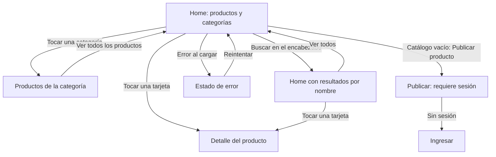

# Inicio (Home)

Pantalla pública en `/` (`PATHS.inicio`), implementada en la rama `feat/home`.

## Comportamiento

- Dos secciones: todas las categorías y productos disponibles ordenados A→Z en español.
- Cada categoría lleva a la pantalla existente `/categorias/:id`, que consulta los productos filtrados y permite
  volver a ver todos. Se incluyen categorías sin productos disponibles.
- Cada tarjeta muestra nombre, precio en pesos argentinos, primera foto y stock; se puede tocar completa para
  abrir el detalle. Reutiliza `ProductoCard`, sin cambiar el componente compartido.
- Oculta productos sin stock y, al iniciar sesión, los del usuario actual, igual que la página de categoría.
- El buscador del encabezado usa `?q=texto`: busca por nombre sin distinguir mayúsculas ni tildes. “Ver todos”
  limpia la búsqueda.
- Estados de carga, error con reintento, catálogo vacío, búsqueda sin resultados y categorías vacías.
- Si una imagen no está disponible, la tarjeta se muestra igualmente con el indicador compartido.
- Una columna de productos en celular pequeño, dos desde 480 px, tres desde 768 px y cuatro desde 1024 px.

## Componentes y datos

La vista obtiene los datos y maneja el estado; los componentes locales reciben props:

- `ListaCategorias`: enlaces a todas las categorías.
- `GrillaProductos`: lista de tarjetas compartidas con títulos de nivel 3.

Se usan los módulos existentes de `src/api/`, que pasan por `apiFetch` y el mock compartido:

- `GET /api/productos`.
- `GET /api/categorias`.
- `GET /api/productos/{id}/imagenes`.

No se agregan campos a los DTO ni se modifican los JSON compartidos. Funciona con los datos de `public/data/`
por defecto y no requiere levantar el backend. El filtro por categoría ya existe en `CategoriaPage` y utiliza
`GET /api/productos?categoriaId=`.

## Wireflow de Home

Las capturas muestran la pantalla implementada y sirven de referencia para pasar el mockup y las flechas al
Figma compartido. No se editó Figma porque no se proporcionó el enlace al archivo del grupo.

- [Escritorio, 1440 px](home/home-escritorio.png).
- [Celular, 375 px](home/home-celular.png).

## Verificación

Con `npm ci` y `npm run dev`, abrir `http://localhost:5173`:

1. Sin sesión aparecen ocho productos con stock, ordenados por nombre, y seis categorías.
2. Buscar “PROGRAMACION”: aparece “Apuntes de Programación 2”. “Ver todos” restaura el catálogo.
3. Buscar una palabra inexistente: se informa que no hay resultados y se puede volver al listado completo.
4. Abrir Electrónica: se ven cuatro productos. Abrir Deportes: se muestra la categoría vacía y la opción de
   ver todos los productos.
5. Tocar una tarjeta o enfocarla con Tab y presionar Enter: se abre el detalle.
6. Con `jperez@uade.edu.ar` / `12345678`, se ven cuatro productos de otros vendedores.
7. Verificar en 320, 375, 768 y 1440 px: sin desborde horizontal.
8. Simular un error de carga de datos: aparece el error y “Reintentar” permite recuperar el catálogo.
9. Simular productos o categorías vacíos y errores de fotos: la pantalla conserva sus estados correspondientes.

También se ejecutan `npm run lint`, `npm run build` y Prettier sobre los archivos de Home.
El chequeo global `npm run format:check` encuentra dos problemas previos a esta rama en
`docs/mis-productos.md` y `src/api/productos.js`. No se reformatearon archivos de otras pantallas.

## Alcance del PR

Solo cambia `src/pages/Home/` y agrega esta documentación con capturas. Reutiliza rutas, estilos base, Navbar,
cliente API, datos y componentes compartidos existentes. No agrega dependencias al proyecto.
